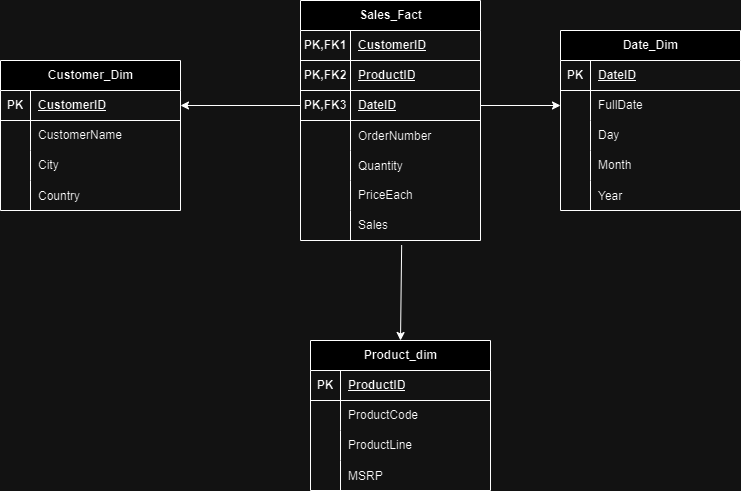
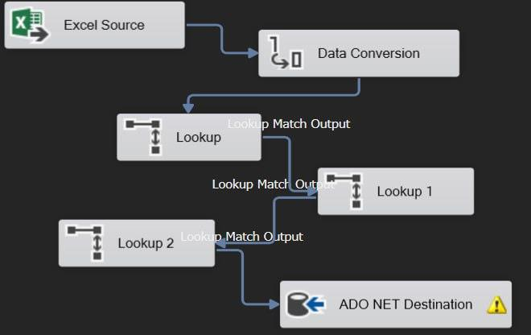
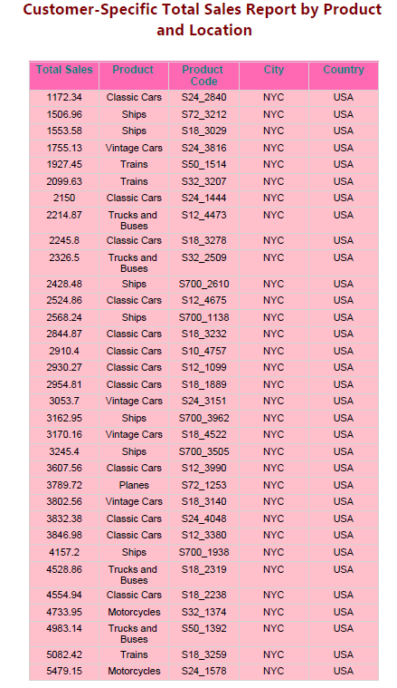
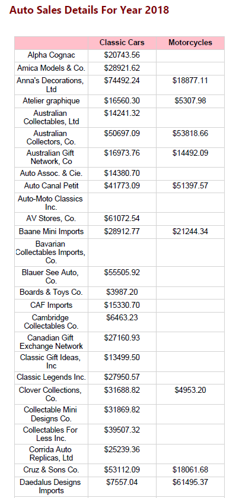
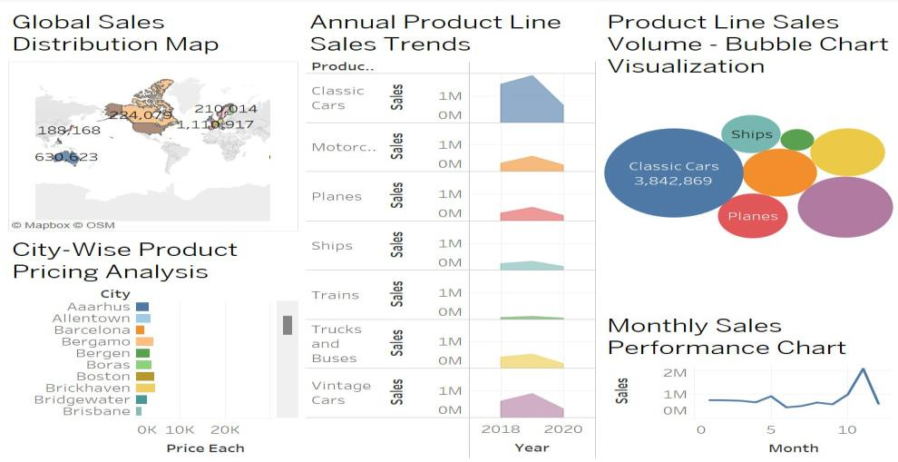

# Auto Sales Data Warehouse (SQL Server · SSIS · SSRS · Tableau)

A sales data mart built on Microsoft SQL Server: a star schema, SSIS packages to load it, SSRS reports and a Tableau dashboard on top, plus a comparison of the same queries in SQL and Neo4j (Cypher).

> **Context:** MSc Data Analytics group project (module B9DA111, Data Storage Solutions for Data Analytics), Dublin Business School, April 2024.
> **Team:** Sayanth Rajani Divakaran and Jerin Pulinthanathu Jose.
> **Data:** the public *Auto Sales data* dataset from Kaggle (order lines for model cars, motorcycles, planes, ships, trains, trucks and buses, 2018–2020).

**Tools:** SQL Server Express · SQL Server Management Studio · Visual Studio (SSIS and SSRS projects) · Tableau · Neo4j

---

## Star schema

One fact table (`Sales_Fact`: quantity, price each, sales) linked to three dimensions: `Customer_dim`, `Product_dim` and `Date_dim`.



Table definitions: [`sql/01_create_tables.sql`](sql/01_create_tables.sql)

## ETL with SSIS

Four SSIS packages in [`ssis/AutoSalesProject`](ssis/AutoSalesProject) load the warehouse from the source Excel file:

| Package | What it does |
|---|---|
| `CustomerPackage.dtsx` | Loads customer name, city and country into `Customer_dim` |
| `ProductPackage.dtsx` | Loads product code, product line and MSRP into `Product_dim` |
| `DatePackage.dtsx` | Sorts by order date and uses a **Derived Column** to split each date into day, month and year before loading `Date_dim` |
| `FactPackage.dtsx` | Converts data types, then uses three **Lookup** transformations to find each order line's customer, product and date keys before loading `Sales_Fact` |



## Reporting with SSRS

Four reports in [`ssrs/AutoWarehouseReportSSRS`](ssrs/AutoWarehouseReportSSRS), built on stored procedures in [`sql/02_report_procedures.sql`](sql/02_report_procedures.sql):

- **Tabular report:** items sold by product line, month and year
- **Parameterised report:** total sales by product for a customer chosen at run time (`@CustomerID`)
- **Matrix report:** 2018 sales by customer and product line
- **Wizard report:** product sales with MSRP for 2018–2020

| Parameterised report | Matrix report |
|---|---|
|  |  |

## Tableau dashboard

[`tableau/auto_sales_dashboard.twbx`](tableau/auto_sales_dashboard.twbx): global sales map, product-line trends by year, product-line sales volume, city-level pricing and monthly sales.



## SQL vs graph database

The same questions were answered in SQL Server ([`sql/03_analysis_queries.sql`](sql/03_analysis_queries.sql)) and Neo4j ([`cypher/neo4j_queries.cypher`](cypher/neo4j_queries.cypher)), for example top customers by quantity, customers per city and buyers of a given product. Relationship questions (who bought what, and when) were more direct to express in Cypher, while SQL needed joins across the fact and dimension tables to answer them.

---

## Known limitations (and what I would do differently)

I am leaving these visible because they are the main lessons from the project.

1. **The dimension tables are not deduplicated.** The customer and product packages copy every source row straight into the table, so those dimensions have one row per order line rather than one row per customer or product: `Customer_dim` has 1,000 rows but only 89 distinct customers, and `Product_dim` has 1,000 rows for 40 distinct products. `Date_dim` also repeats dates (492 rows for 246 distinct dates). Counts by city or by product from the dimension tables are therefore inflated.
   **Fix:** add a Sort transformation with *remove duplicate rows* (or load from a `SELECT DISTINCT` staging query) in each dimension package, so the fact table's Lookups return one true key per customer, product and date.
2. **The fact table's primary key is (ProductID, CustomerID, DateID).** Once the dimensions are deduplicated, two order lines for the same customer, product and day would clash. The grain should be one row per order line, keyed on `OrderNumber` plus order line number, or a surrogate key.
3. **Connection strings point to my local machine** (`RDSAYANTH\SQLEXPRESS` and a local Excel path). To run the packages elsewhere, update the connection managers and the shared data source.

My later project [NorthBay Retail](https://github.com/rdsayanth/northbay-retail-commercial-reporting) applies these lessons: a raw → staging → warehouse pipeline in PostgreSQL with properly deduplicated dimensions.

## Repository structure

```
sql/        Create tables, SSRS stored procedures, analysis queries
ssis/       Visual Studio SSIS project (4 packages)
ssrs/       Visual Studio SSRS project (4 reports + shared data source)
tableau/    Tableau packaged workbook
cypher/     Neo4j queries
data/       Warehouse tables exported to CSV
images/     Screenshots
```

## How to open

- **SSIS / SSRS:** open the `.sln` files in Visual Studio with the *SQL Server Integration Services Projects* and *Reporting Services Projects* extensions installed.
- **Database:** run `sql/01_create_tables.sql` in SQL Server, then run the SSIS packages (or import the CSVs in `data/`).
- **Tableau:** open `tableau/auto_sales_dashboard.twbx` in Tableau Desktop or Tableau Public.
